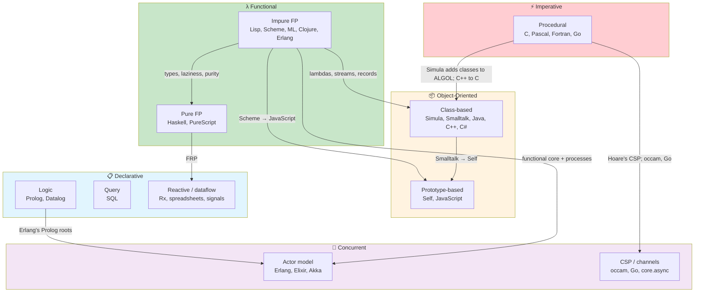
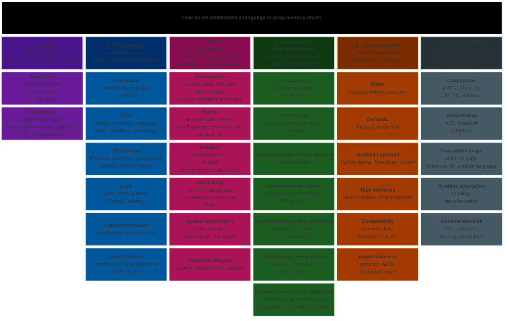
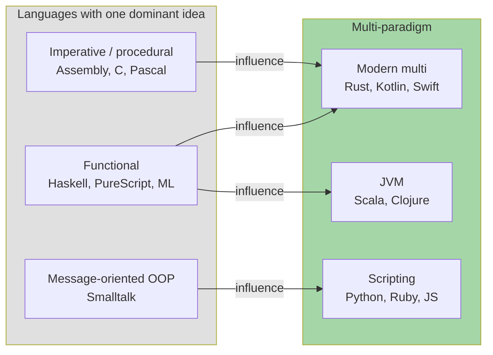
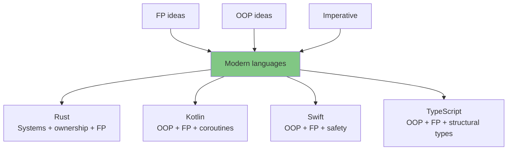
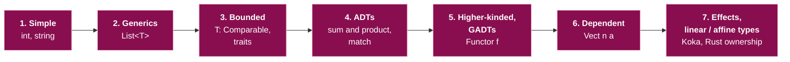
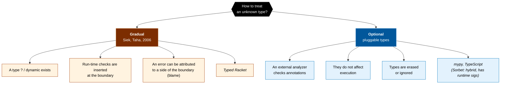
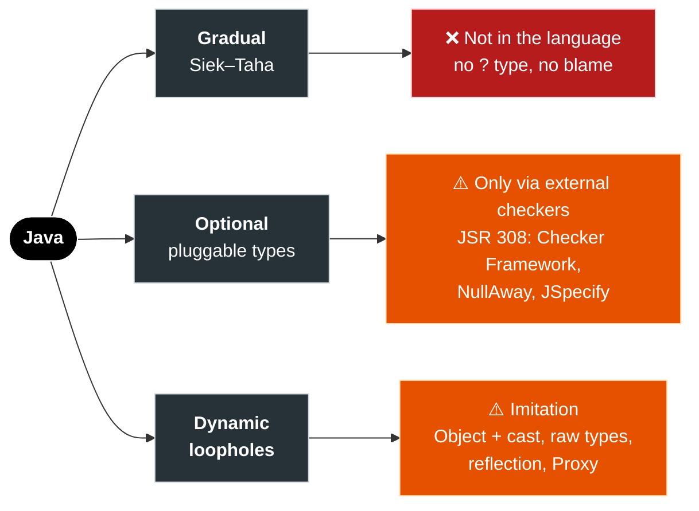

# Paradigms Map

How programming paradigms relate, overlap, and influenced each other over time.

## Contents

**I. Foundations**

- [1. What a paradigm is](#1-what-a-paradigm-is)
- [2. Paradigm overview: influence map](#2-paradigm-overview-influence-map)
- [3. Six complementary questions](#3-six-complementary-questions)

**II. Dimensions in detail** *(A–F are subsections of section 3)*

- [A. Control and description](#a-control-and-description)
- [B. Organization and abstraction](#b-organization-and-abstraction)
- [C. State and effects](#c-state-and-effects)
- [D. Concurrency and coordination](#d-concurrency-and-coordination)
- [E. Type discipline](#e-type-discipline)
- [F. Implementation strategy](#f-implementation-strategy)
- [4. Additional dimensions](#4-additional-dimensions)

**III. Practice**

- [5. Declarative techniques and DSLs](#5-declarative-techniques-and-dsls)
- [6. Languages at a glance](#6-languages-at-a-glance)
- [7. Modern multi-paradigm synthesis](#7-modern-multi-paradigm-synthesis)
- [8. Paradigm selection guide](#8-paradigm-selection-guide)
- [9. Key ideas](#9-key-ideas)

**IV. History**

- [10. Timeline](#10-timeline)

**V. Deep dives**

- [11. Type discipline: deep dive](#11-type-discipline-deep-dive)
  - [11.1 Annotations and type inference](#111-annotations-and-type-inference)
  - [11.2 Nominal and structural compatibility](#112-nominal-and-structural-compatibility)
  - [11.3 Expressiveness](#113-expressiveness)
  - [11.4 Guarantees](#114-guarantees)
  - [11.5 Gradual integration](#115-gradual-integration)
- [12. Case study: gradual and optional typing in Java](#12-case-study-gradual-and-optional-typing-in-java)

**VI. Reference**

- [13. Further reading](#13-further-reading)
- [See also](#see-also)

---

## 1. What a paradigm is

A **paradigm** is a style of programming built on a set of concepts, abstractions, and conventions about computation.

- Paradigms **overlap**, so it is better to picture them as regions on a multidimensional map than as branches of a tree.
- Not every language property is a paradigm. Typing discipline, garbage collection, and compilation strategy answer different questions.
- Keep these apart:
  - the **language** (constructs and their meaning);
  - the **implementation** (compiler, interpreter, runtime);
  - the **style** (how developers actually use the language);
  - **libraries and frameworks** (they can add models: actors, reactive streams, declarative configuration).

Example: "Java with immutable domain objects, Reactor, and HotSpot" is a more accurate description than "Java is OOP".

---

## 2. Paradigm overview: influence map

The diagram below is a **historical sketch**, not a taxonomy. The boxes mix different dimensions (for example, "Declarative" is a style of description and "Concurrent" is a coordination model), and one language can appear in several of them. Arrows mean "influenced / was adopted by", not a strict "evolved into".



---

## 3. Six complementary questions



**How to read the diagram**

- Color marks the dimension (A–F); the italic lines inside the blocks give examples of languages and technologies.
- Branches are not mutually exclusive. One language passes through several branches. Java, for example: A (imperative + declarative APIs) → B (OOP) → D (threads, reactive libraries) → E (static, nominal) → F (bytecode + JIT).
- Branches inside one dimension are not necessarily alternatives either. In D, concurrency and parallelism can be combined, and in B different models are often mixed in one program.
- **A is a scale, not a ranking.** Imperative and declarative are two ends of one axis: loops → pipelines → relations and constraints. More declarative does not mean better (see [A. Control and description](#a-control-and-description)).
- **E has three separate questions about analysis guarantees:** (1) type safety, (2) precision of diagnostics (no false alarms), (3) coverage of analysis (no missed errors). They are not interchangeable (see [E. Type discipline](#e-type-discipline) and [11.4](#114-guarantees)).
- **F does not define language semantics.** The implementation (compiler, interpreter, JIT, runtime) is one thing and the language is another (see [F. Implementation strategy](#f-implementation-strategy)).

| | Dimension | Question |
|---|---|---|
| **A** | Control and description | How is the computation described? |
| **B** | Organization and abstraction | What concepts is the code built around? |
| **C** | State and effects | How are change and interaction with the outside world represented? |
| **D** | Concurrency and coordination | How do activities coexist and communicate? |
| **E** | Type discipline | What constraints are expressed and checked? |
| **F** | Implementation strategy | How is the program translated and executed? |

The dimensions are not strictly orthogonal: a paradigm can affect several of them at once.

### A. Control and description

- **Imperative style**: commands, state changes, control flow.
- **Declarative style**: a description of relations or the desired result, while some operational decisions are left to an evaluator, solver, or framework.

This is a scale, not a ranking. Imperative and declarative are **two ends of one axis**, ordered by how explicitly you spell out the steps:

```text
More explicit control ───────────────────────────► More declarative

loops and state updates → transformation pipelines → relations and constraints
```

The degree of declarativeness depends on the construct and the problem domain.

#### ⚡ Imperative programming

**Core idea:** programs as sequences of commands that change state.

| Aspect | Description |
|--------|-------------|
| **Focus** | How to do something (step by step) |
| **State** | Mutable, explicit |
| **Control** | Loops, conditionals, goto (in older languages) |
| **Languages** | C, Go, Pascal, Fortran, Ruby (in its basic style) |

```c
// Imperative: explicit steps
int sum = 0;
for (int i = 0; i < n; i++) {
    sum += arr[i];
}
```

**Strengths:** direct mapping to hardware, predictable performance, explicit control flow.

**Weaknesses:** state management gets complex as programs grow; shared mutable state makes parallelization harder.

#### 📋 Declarative programming

**Core idea:** describe what you want, not how to get it.

| Aspect | Description |
|--------|-------------|
| **Focus** | Specification of the desired result |
| **Languages and tools** | SQL, Prolog, Datalog, HTML/CSS, Terraform, Haskell (expression style) |

```sql
-- Declarative: what, not how
SELECT name FROM users WHERE age > 18;
```

**Strengths:** expressiveness, optimization opportunities for the evaluator, domain focus.

**Weaknesses:** less control, behavior (especially performance) can be opaque.

#### Examples on the scale

- A Java loop with an accumulator is imperative. `stream().map().filter().reduce()` is more declarative with respect to traversal, but the order of transformations is still specified.
- SQL leaves the choice of execution plan to the DBMS, but it still states the exact relational operation.

### B. Organization and abstraction

| Model | Idea | Key abstractions |
|---|---|---|
| **Procedural** | Procedures operate on data | Procedures, functions, modules |
| **OOP** | Objects expose behavior through interfaces | Objects, methods, messages, interfaces |
| **Functional** | Functions and expressions compose transformations | First-class functions, composition, values |
| **Logic** | Relations describe what is true; queries search for solutions | Predicates, facts, rules, logic variables |
| **Component-based** | Components are connected through contracts | Components, ports, interfaces, lifecycle |
| **Concatenative** | Program fragments are composed by juxtaposition | Words, quotations, composition |

The models are not mutually exclusive and live at different levels. Component-based development, for example, mostly describes large-scale architecture.

#### Procedural

The unit of organization is the procedure, often inside a module. Languages: C, Pascal, Fortran, BASIC. It rests on the ideas of structured programming: sequence, selection, iteration.

#### 📦 Object-oriented programming

**Core idea:** a program is a set of objects that encapsulate state and expose behavior through methods or messages.

| Aspect | Description |
|--------|-------------|
| **Focus** | Data + behavior bundled together |
| **State** | Encapsulated in objects |
| **Key concepts** | Encapsulation, polymorphism, inheritance (in class-based flavors), message passing |
| **Languages** | Simula, Smalltalk, Self, C++, Java, C#, Python, Ruby, JavaScript, Kotlin |

```java
// OOP: objects with behavior
class Account {
    private double balance;

    public void deposit(double amount) {
        this.balance += amount;
    }
}
```

- *The Kay / Smalltalk line:* message passing, hidden state, the latest possible binding.
- *The Simula line:* classes, inheritance, virtual methods, domain modeling (influenced C++, Java, C#).
- Classes are not required: in **prototype-based OOP** (Self, JavaScript) reuse is built on objects and delegation.
- Objects can be immutable, and methods can be free of side effects.

**Subparadigms**

- **Class-based** (Smalltalk, Java, C++): objects are instances of classes.
- **Prototype-based** (JavaScript, Self): objects are cloned from, or delegate to, other objects.

**Strengths:** modeling real-world domains, code reuse, encapsulation.

**Weaknesses:** inheritance hierarchies can become rigid; shared mutable state.

#### λ Functional programming

**Core idea:** programs as a composition of functions and expressions that transform (preferably immutable) data.

| Aspect | Description |
|--------|-------------|
| **Focus** | What to compute (transformations) |
| **State** | Immutable values (by default or by convention) |
| **Key concepts** | Pure functions, higher-order functions, recursion |
| **Languages** | Lisp, Scheme, ML, Haskell, OCaml, Erlang, Clojure, F#, Scala, Elixir |

```haskell
-- Functional: declarative transformation
mySum :: Num a => [a] -> a
mySum = foldr (+) 0
```

- A **pure function** has no side effects and depends only on its arguments.
- **Referential transparency:** an expression can be replaced by its value without changing behavior.
- **Immutable and persistent data structures:** old and new versions coexist and share the unchanged part.
- **Algebraic data types and pattern matching** (especially in statically typed languages).
- The functional style allows mutability, exceptions, and I/O. "Pure" FP restricts effects strictly.

**Subparadigms**

- **Pure FP** (Haskell, PureScript): effects are tracked in the type system.
- **Impure FP** (Lisp, Clojure, ML, OCaml, Erlang): functional style with pragmatic escape hatches.

**Strengths:** testability, safety under concurrency, ease of reasoning.

**Weaknesses:** learning curve; performance overhead (often mitigated in practice).

#### Logic programming

A program is a set of facts and rules, and execution is the answer to a query.

- It has a *declarative reading* (which relations hold) and an *operational* one (how the implementation searches for an answer).
- In Prolog: unification and depth-first search with backtracking. The order of clauses and goals affects performance, answer order, and termination.
- Practical Prolog has `cut`, I/O, and effects. Negation as failure is not classical negation.
- **Constraint logic programming** combines relations with specialized constraint solvers.
- Datalog usually evaluates rules to a fixed point instead of backtracking search.
- Languages and systems: Prolog, Datalog, miniKanren, core.logic.

#### Applicative and concatenative style

These concern how application and composition are expressed.

- *Applicative:* a function is applied to explicit arguments: `f(g(x))`. Do not confuse it with applicative-order evaluation (arguments are evaluated before the call) or with the `Applicative` type class in Haskell.
- *Concatenative:* juxtaposing program fragments means composing them. Often (but not necessarily) an implicit stack is used: `3 4 + 2 *`. Languages: Forth, Factor, Joy, PostScript.
- Related but distinct notions: **stack-based** (an operand model) and **point-free / tacit** (an expression without explicit arguments, e.g. `filter positive . map double`).

### C. State and effects

An **effect** is an observable interaction beyond returning a value: mutation, I/O, an exception.

- **Immutability**: a value does not change after creation.
- **Purity**: computation without observable effects; the result depends only on the inputs.
- **Isolation**: limiting which computations have access to state.
- **Ownership**: controlling responsibility for a value or resource and access to it. It does not necessarily forbid mutation.

| Aspect | Approaches |
|---|---|
| Data mutation | Mutable objects and arrays; immutable values and persistent structures |
| State sharing | Shared references; actor-local state; access controlled by ownership |
| Expressing effects | Ordinary calls with effects; explicit effectful computations; effect systems |
| Update coordination | Locks, atomics, transactions, message passing |
| Resource lifecycle | Explicit cleanup, RAII, scoped management, ownership |

Immutability does not protect against stale snapshots, bugs in update logic, or races on external resources.

### D. Concurrency and coordination

| Concept | Essence | Examples |
|---|---|---|
| Sequential computation | No simultaneous progress at the level considered | A simple batch algorithm |
| **Concurrency** | Several logical activities can make progress | Goroutines, Erlang processes, async tasks |
| **Parallelism** | Computations execute physically at the same time | Multicore, GPU |
| Communication | Exchange of information or coordination of access | Shared memory, actors, channels |
| Event-driven organization | Events trigger handlers or state transitions | GUI, Node.js |
| Reactive / dataflow | Dependencies or streams drive change propagation | Spreadsheets, reactive streams |

- **Concurrency ≠ parallelism:** the first is about structuring activities, the second about simultaneous execution.
- A program can be event-driven, concurrent, and parallel at the same time.
- Event-driven and reactive programming overlap but are not synonyms: in reactive programming the dependencies and propagation rules are explicit.

#### 🔄 Actor model

**Core idea:** isolated actors communicate through asynchronous messages (Hewitt, Bishop, Steiger, 1973).

| Aspect | Description |
|--------|-------------|
| **Key insight** | No shared state between actors |
| **Languages and libraries** | Erlang, Elixir, Akka (Scala/Java) |

In response to a message, an actor can send messages, create actors, and define its behavior for the next messages. Communication is asynchronous, and the recipient is identified by actor identity. Usually an actor has private state and processes messages sequentially. Delivery, ordering, and failure semantics depend on the implementation.

```erlang
% Erlang: actors receive messages
loop(State) ->
    receive
        {add, X} -> loop(State + X);
        {get, Pid} -> Pid ! State, loop(State)
    end.
```

#### CSP (Communicating Sequential Processes)

**Core idea:** independent sequential processes synchronize through shared events (Hoare, 1978). In the classical model this is a rendezvous.

| Aspect | Description |
|--------|-------------|
| **Key insight** | The channel (or event) is the synchronization point |
| **Languages** | occam, Go, Clojure (core.async) |

Modern implementations usually provide channels, so they are more accurately called **CSP-inspired**.

```go
// Go: CSP-style channels
ch := make(chan int)
go func() { ch <- 42 }()
value := <-ch
```

#### Actors vs CSP

| | Actors | CSP / channels |
|---|---|---|
| Point of contact | Actor identity / address | Channel or shared event |
| Interaction | Asynchronous send | Rendezvous or buffered operations |
| Synchronization | Through message protocols | Tied to the communication itself |

Neither model by itself solves the problems of distributed systems, deadlocks, or overload.

### E. Type discipline

- **Static typing:** constraints are checked before the code runs.
- **Dynamic typing:** type properties are checked at run time.

Static languages also perform run-time checks, and dynamic ones can get static analysis.

| Dimension | Question | Examples |
|---|---|---|
| Annotations and inference | What must be written and what is inferred | Local inference in Java and Rust; extended inference in the ML family |
| Nominal / structural compatibility | Compatibility is determined by declaration, structure, or both | Java classes; TypeScript object types; Go interfaces |
| Expressiveness | What can be described by types | Generics, ADTs, dependent types, effect types |
| Guarantees | What a successful check establishes | Type safety (soundness) in the safe subset |
| Gradual integration | How typed and unknown values interact | Python typing, TypeScript, Sorbet |

- The terms "strong/weak typing" are defined inconsistently. It is better to be specific: casts, checks, memory safety, type-system guarantees.
- **Gradual typing** (Siek, Taha, 2006) studies the coexistence of statically and dynamically typed parts. **Optional typing** is not the same: the check may not affect execution. A sound gradual system may insert checks at the boundaries.
- **Three different questions about analysis guarantees:**
    1. *Type safety:* can an accepted program perform a forbidden operation? (In type theory this property is called soundness of the type system.)
    2. *Precision of diagnostics (no false alarms):* is every reported error real, and are correct programs accepted?
    3. *Coverage of analysis (no missed errors):* will all errors of the chosen class be found?
- **A note on terminology.** In static analysis, "sound" usually means "no missed errors" and "complete" means "no false alarms". Communities use these words differently, so this document uses neutral names.
- The absence of warnings does not prove correctness: types usually do not guarantee termination, absence of exceptions, or correct business logic.

The [deep dive](#11-type-discipline-deep-dive) covers each axis in detail.

| Ecosystem | Mechanism | Run-time behavior | Limitation |
|---|---|---|---|
| Python + mypy/Pyright | External static analysis | Annotations usually not checked | `Any`, untyped code |
| TypeScript | Static structural checking | Types are erased | Intentional unsoundness (not only `any`) |
| Java (javac + JVM) | Static nominal checking, local type inference; optional pluggable checkers via JSR 308; no gradual typing | Class types are preserved; casts are checked; bytecode verifier | Generics erasure, `null`, unchecked casts, reflection, `Object` |
| Ruby + Sorbet | Static analysis + runtime signatures (sorbet-runtime) | `sig` checks at run time when the runtime library is used; depends on configuration | `T.untyped` |
| Clojure + spec | Validation, instrumentation, generative testing | Checks where enabled | Not a static guarantee for the whole program |
| Elixir | Evolving compiler analysis, set-theoretic types | BEAM runtime | Depends on the release |
| Haskell | Static checking, broad inference | No boundary-checking layer | Exceptions, non-termination, unsafe |

### F. Implementation strategy

- A **compiler** translates a program from one representation to another.
- An **interpreter** executes a program by processing its representation.
- These are mechanisms, not mutually exclusive categories of languages. A system can compile to one representation and interpret the next. One language can have implementations with different strategies.

| Property | Options |
|---|---|
| Compilation time | AOT (ahead of time), JIT (at run time), combinations |
| Translation target | Machine code, bytecode, another intermediate representation, another source language |
| Interpretation level | Syntax tree, bytecode, other |
| Run-time adaptation | Profiling, specialization, tiered compilation, deoptimization |
| Runtime services | Garbage collection, scheduler, dynamic loading, exceptions |

Typical pipelines (not an essence of the language):

- **C (GCC/Clang):** source → IR → native object code → executable.
- **Rust (rustc + LLVM):** source → AST → HIR → THIR → MIR → LLVM IR → object code → executable. MIR is used for the borrow checker, analyses, and optimizations. Miri interprets MIR to find undefined behavior.
- **Java (HotSpot):** source → JVM bytecode → interpretation and tiered JIT.
- **Python (CPython):** source → AST → bytecode → its execution. **PyPy:** interpreter plus a tracing JIT.
- **JavaScript (V8):** source → bytecode → interpretation and tiered JIT.
- **TypeScript:** type checking plus JS generation, then the JS engine's pipeline; types are erased.
- **Haskell (GHC):** source → Core → STG → native code (interactive modes exist too).
- **Erlang/Elixir:** source → BEAM code → interpreter or the BeamAsm JIT.

The implementation does not define semantics: JIT does not imply dynamic typing, bytecode does not imply interpretation, native compilation does not imply manual memory management, and laziness does not imply interpretation.

---

## 4. Additional dimensions

- **Evaluation strategy:** call by value, by name, by need; strict and non-strict semantics. Haskell is non-strict (usually call-by-need), but that does not give automatic parallelism.
- **Memory and resource management:** manual, tracing GC, reference counting, ownership and borrowing, deterministic cleanup.
- **Modularity:** modules, interfaces, traits, functors, separate compilation.
- **Metaprogramming:** macros, reflection, code generation, compile-time evaluation.
- **Determinism and search:** deterministic computation, nondeterministic choice, backtracking, probabilistic computation.
- **Problem domain:** general-purpose languages, DSLs, query, modeling, and configuration languages.

---

## 5. Declarative techniques and DSLs

| Technique | Area | Declarative element |
|---|---|---|
| SQL | Data access | Relations, filtering, grouping |
| HTML/CSS | Documents and presentation | Structure, semantics, style |
| Regular expressions | Text matching | Patterns of acceptable text |
| Build systems | Dependencies | Targets and dependencies |
| Infrastructure as code | Deployment | Desired resources and configuration |
| Constraint programming | Search and optimization | Variables, domains, constraints |
| Reactive / dataflow systems | Change propagation | Dependencies and stream transformations |

In practice styles are mixed: a Makefile combines dependencies with imperative recipes, the Gradle DSL can execute arbitrary code, and SQL has procedural extensions.

**Annotations** are a mechanism, not a paradigm (Spring's `@Transactional` works through proxies and interceptors). **Aspect-oriented programming** moves cross-cutting concerns (logging, security, transactions) into separate modules.

---

## 6. Languages at a glance

### Focused vs. multi-paradigm languages

"Focused" here means a language built around one dominant idea. Even these languages are rarely pure: Haskell has `IO` and `unsafePerformIO`, and C has function pointers and ad hoc "objects". Arrows show influence.



### Summary table

Typical styles and capabilities, not an exclusive classification.

| Language | A: control | B: organization | C: state | D: concurrency | E: types | F: implementation |
|---|---|---|---|---|---|---|
| **C** | Imperative | Procedural, modular | Explicit mutation, manual resources | Threads, atomics, libraries | Static, explicit declarations | AOT, native code |
| **Java** | Imperative + declarative APIs | Class-based OOP, functional elements | Mutable and immutable objects | Threads, executors, virtual threads, reactive libraries | Static, nominal, partial inference; optional pluggable checkers | JVM bytecode, interpretation/JIT |
| **Haskell** | Expressions, declarative | Functional | Pure expressions, explicit effects | Explicit concurrency, parallel abstractions | Static, broad inference | GHC, native code |
| **Erlang/Elixir** | Expressions, pattern matching | Functional, process-based | Immutable values, process-local state | Lightweight processes, async messages | Dynamic base; Elixir is developing analysis | BEAM |
| **Go** | Imperative | Procedural, interfaces and methods | Mutation, shared memory or channels | Goroutines, channels | Static, structural interfaces | AOT + runtime |
| **Rust** | Imperative + expressions | Procedural, functional elements, traits | Ownership and borrowing | Threads, channels, atomics, async | Static, nominal, local inference | rustc + LLVM |
| **Clojure** | Functional transformations | Functional | Persistent values, atoms, refs, agents | JVM concurrency, STM, core.async | Dynamic, optional spec | JVM |
| **SQL** | Declarative | Query-based | Queries read, statements modify | Planning and parallelism in the DBMS | Typed, dialect-dependent | DBMS planner and executor |
| **Prolog** | Relations + operational search | Logic | Logic bindings, practical effects | Usually sequential search | Usually dynamic | Implementation-dependent |
| **Python** | Mixed | Procedural, OOP, functional elements | Mutable and immutable values | Threads, processes, async | Dynamic, optional analysis | CPython: bytecode |
| **TypeScript** | Mixed | OOP, functional, component-based | JS state and effects | Events, promises, workers | Static structural; optional typing (types erased) | JS generation + JS engine |
| **Ruby** | Imperative + functional idioms | OOP, blocks, modules | Mutable objects | Threads, fibers, processes | Dynamic, Sorbet/RBS | Interpreter, VM, JIT |
| **Forth** | Explicit stack operations | Concatenative, words | Stack, memory, I/O | Implementation-dependent | Usually no static checking | Threaded code, native compilation, interpretation |

---

## 7. Modern multi-paradigm synthesis

Modern languages blend paradigms:



**Key insight:** the best modern code typically combines:

- **Immutability by default** (from FP)
- **Encapsulation** (from OOP)
- **Explicit effects** (from pure FP)
- **Controlled ownership of state and resources** (from Rust and RAII)
- **Pragmatic escape hatches** (from imperative languages)

---

## 8. Paradigm selection guide

These are starting points, not rules. Team skills, ecosystem, and constraints often matter more than the paradigm.

| Problem domain | Often a good fit | Why |
|----------------|------------------|-----|
| System utilities | Imperative / procedural (Go, Rust, C) | Direct, efficient, predictable |
| Business applications | OOP + FP mix (Kotlin, C#, Java) | Domain modeling, mature ecosystems |
| Data pipelines | Functional style (Clojure, Elixir, Scala) | Transformations compose well |
| Highly concurrent services | Actors / CSP (Erlang, Elixir, Go) | Isolation, lightweight activities |
| Correctness-critical logic | Functional style with expressive types (Haskell, Idris, OCaml) | Types encode invariants |
| Quick scripting | Multi-paradigm (Python, Ruby) | Flexibility, short feedback loop |
| Querying and reporting | Declarative (SQL, Datalog) | The engine optimizes execution |
| Infrastructure | Declarative (Terraform, Kubernetes manifests) | Desired state instead of steps |

---

## 9. Key ideas

- A paradigm is a region on a map, not a mutually exclusive label. One language supports several styles.
- Imperative/declarative, FP/OOP, actors/CSP, typing, and implementation are **different questions**.
- For types, it is more useful to ask "what guarantees are given, at what boundaries, under what assumptions, and at what cost" than "which system is better".
- **Functional Core / Imperative Shell** (Gary Bernhardt): business logic in a pure core, I/O and coordination at the boundaries.
- No paradigm by itself guarantees readability, performance, testability, or maintainability.

---

## 10. Timeline

| Year | Event |
|---|---|
| 1930s / 1936 | Lambda calculus (Church); the Turing machine |
| 1957 | Fortran |
| 1958 | Lisp |
| 1960 | ALGOL 60 |
| 1967 | Simula 67 |
| 1968 | Dijkstra: "Go To Statement Considered Harmful" |
| late 1960s – early 1970s | Forth; ML |
| 1972 | Prolog, Smalltalk-72, C |
| 1973 | The actor model |
| 1975 | Scheme |
| 1977–1978 | Backus's lecture on the von Neumann style (given 1977, published 1978); CSP (1978); Milner's polymorphic type inference (1978) |
| 1983–1984 | C++ gets its name; PostScript |
| 1986 | Erlang |
| 1989 | Hughes: "Why Functional Programming Matters" |
| 1990 | Haskell 1.0 |
| 1995–1996 | Java; OCaml |
| 2001–2003 | Joy publications; Factor |
| 2006 | Gradual typing (Siek, Taha) |
| 2007 | Clojure |
| 2009–2010 | Go; Rust announced |
| 2012 | TypeScript |
| 2015 | Rust 1.0 |
| since 2024 | Phased type analysis in the Elixir compiler |

Labels like "the first functional language" or "the invention of OOP" oversimplify history: remember the earlier experiments and later refinements.

---

## 11. Type discipline: deep dive

### Map of five axes

```mermaid
block-beta
    columns 6

    L0[" "]
    H1["<b>1 · Annotations<br/>and inference</b>"]
    H2["<b>2 · Nominal /<br/>structural</b>"]
    H3["<b>3 · Expressiveness</b>"]
    H4["<b>4 · Guarantees</b>"]
    H5["<b>5 · Gradual<br/>integration</b>"]

    L1["<b>Question</b>"]
    Q1["What do we write,<br/>what is inferred?"]
    Q2["Compatible by name<br/>or by shape?"]
    Q3["What can types<br/>describe?"]
    Q4["What does a successful<br/>check promise?"]
    Q5["How do types coexist with<br/>unknown values?"]

    L2["<b>Scale</b>"]
    V1["all explicit → local inference → Hindley–Milner"]
    V2["nominal ↔ structural"]
    V3["generics → ADTs → dependent types"]
    V4["type safety · precision · coverage"]
    V5["gradual ↔ optional"]

    L3["<b>Examples</b>"]
    E1["Java var, Rust, OCaml"]
    E2["Java ↔ TypeScript, Go"]
    E3["Rust enum, Idris"]
    E4["safe Rust ↔ unsafe"]
    E5["TypeScript, mypy, Sorbet"]

    L4["<b>Risk</b>"]
    R1["error far from its cause"]
    R2["accidental compatibility"]
    R3["complexity, slow checking"]
    R4["erasure, any, unsafe"]
    R5["errors at boundaries"]

    classDef lbl fill:#eceff1,color:#263238,stroke:#b0bec5
    classDef h1 fill:#4a148c,color:#fff,stroke:#e1bee7,stroke-width:2px
    classDef h2 fill:#002f6c,color:#fff,stroke:#bbdefb,stroke-width:2px
    classDef h3 fill:#880e4f,color:#fff,stroke:#f8bbd0,stroke-width:2px
    classDef h4 fill:#0d3b12,color:#fff,stroke:#c8e6c9,stroke-width:2px
    classDef h5 fill:#7c2d00,color:#fff,stroke:#ffe0b2,stroke-width:2px
    classDef c1 fill:#f3e5f5,color:#000,stroke:#8e24aa
    classDef c2 fill:#e3f2fd,color:#000,stroke:#0277bd
    classDef c3 fill:#fce4ec,color:#000,stroke:#c2185b
    classDef c4 fill:#e8f5e9,color:#000,stroke:#2e7d32
    classDef c5 fill:#fff3e0,color:#000,stroke:#a33a00

    class L0,L1,L2,L3,L4 lbl
    class H1 h1
    class H2 h2
    class H3 h3
    class H4 h4
    class H5 h5
    class Q1,V1,E1,R1 c1
    class Q2,V2,E2,R2 c2
    class Q3,V3,E3,R3 c3
    class Q4,V4,E4,R4 c4
    class Q5,V5,E5,R5 c5
```



### 11.1 Annotations and type inference

> **Question:** how much about types does the programmer write, and how much does the compiler reconstruct?

This is the "verbosity ↔ inference" axis. It has nothing to do with static vs. dynamic: with inference the types remain static, they are just not written explicitly.

| Level | What is written | Examples |
|---|---|---|
| All explicit | Types of variables, parameters, results | C, older Java (before diamond, lambdas, and `var`) |
| Local inference | Local variable types are inferred, signatures are written | Java `var`, Go `:=`, Rust |
| Extended (Hindley–Milner) | Almost nothing; function types are inferred too | OCaml, Haskell, SML |

```java
var names = new ArrayList<String>();   // Java: the type comes from the right-hand side
```

```rust
fn total() -> u32 {
    let mut v = Vec::new();   // element type not yet known
    v.push(5u32);             // inferred: Vec<u32>
    v.iter().sum()
}
```

```haskell
add x y = x + y   -- GHC infers: Num a => a -> a -> a
```

**Subtleties**

- Local inference in Java and Rust differs. Java looks only at the initializer, while Rust takes the later uses of the variable into account.
- Hindley–Milner does not combine well with subtyping and overloading, so OOP languages usually have local inference.
- Top-level signatures are customarily written even in Haskell: they serve as documentation and give clearer errors.

### 11.2 Nominal and structural compatibility

> **Question:** does a type fit by a declared relationship or by the composition of its members?

```java
// Java: nominal
interface Drawable { void draw(); }
class Circle { public void draw() {} }
Drawable d = new Circle();          // error: no "implements"
```

```typescript
// TypeScript: structural
interface Drawable { draw(): void }
class Circle { draw() {} }
const d: Drawable = new Circle();   // OK
```

```go
// Go: interfaces are structural
type Drawer interface { Draw() }
type Circle struct{}
func (Circle) Draw() {}
var d Drawer = Circle{}             // OK
```

| | Pros | Cons |
|---|---|---|
| **Nominal** | Explicit intent, `Meters` ≠ `Feet` | Must be declared up front; hard to adapt foreign types |
| **Structural** | Flexibility, loose coupling | Accidental compatibility |

**Subtleties**

- Pure systems are rare. Go interfaces are structural, but `type UserID int` is nominal. TypeScript has "branding": `string & { __brand: 'UserId' }`.
- Rust traits are nominal (an explicit `impl` is required). Python has both options: ABCs and `typing.Protocol`.

### 11.3 Expressiveness

> **Question:** which properties of a program can be written in types and enforced by the compiler?



```rust
// ADT: an invalid state is unrepresentable
enum Payment {
    Cash,
    Card { number: String },
    Invoice { id: u64 },
}
// match must cover all variants
```

```idris
-- Dependent types: the vector length is part of the type
append : Vect n a -> Vect m a -> Vect (n + m) a
```

**Subtleties**

- "Make invalid states unrepresentable" is already achievable with ADTs; dependent types are not needed for it.
- The price of expressiveness: complex errors, slow checking, a high entry barrier.
- TypeScript's type system is rich enough to compute with (it is Turing-complete), so the checker has to impose recursion-depth limits.
- Rust's ownership is based on affine types (a value can be used at most once), which is weaker than strictly linear types.

### 11.4 Guarantees

> **Question:** what exactly does the compiler claim when the check has passed?

**Types usually do not guarantee:** termination, absence of exceptions, correct business logic, absence of deadlocks and logical races. Safe Rust rules out data races and memory-safety errors, but not deadlocks or logical races.

**Where the guarantee "leaks"**

| Place | Example |
|---|---|
| Unsafe subsets | `unsafe` in Rust, `unsafeCoerce` in Haskell, casts in C |
| Erasure and casts | `List<String>` in Java is not checked after compilation |
| System boundaries | FFI, reflection, deserialization, user input |
| Intentional unsoundness | TypeScript |

```java
List raw = new ArrayList<String>();
raw.add(42);                  // only a warning
List<String> s = raw;
String x = s.get(0);          // ClassCastException, far from the real cause
```

```typescript
const user = JSON.parse(text) as User;   // no check, this is only an assertion
```

**Three questions about analysis guarantees**

| Question | Meaning | What violates it |
|---|---|---|
| Type safety | An accepted program will not perform a forbidden operation (soundness of the type system) | "Holes" in the type system |
| Precision of diagnostics | Every reported error is real; correct programs are not rejected (no false alarms) | False positives |
| Coverage of analysis | All errors of the chosen class are found (soundness in the static-analysis sense) | Missed errors |

Type safety is, in essence, coverage for one specific class of errors: operations that are forbidden at run time.

Terminology differs between communities. In static analysis, "sound" usually means "no missed errors" and "complete" means "no false alarms". That is why the table uses neutral names.

By Rice's theorem, every non-trivial semantic property of programs is undecidable. A terminating analysis therefore cannot get everything at once: it either rejects some correct programs or lets some errors through.

### 11.5 Gradual integration

> **Question:** how do typed code and values of unknown type coexist?



```python
def double(x: int) -> int:
    return x * 2


double("ab")   # mypy: error; interpreter: returns "abab"
```

| Ecosystem | "Unknown" type | At run time |
|---|---|---|
| Python + mypy/Pyright | `Any` | Annotations are not checked |
| TypeScript | `any`, the safer `unknown` | Types are erased |
| Ruby + Sorbet | `T.untyped` | `sig` is checked by sorbet-runtime when it is used (hybrid model) |
| Typed Racket | `Any` | Contracts at the boundaries |

**Subtleties**

- The main value is gradual migration (JS → TypeScript, Python module by module). Migration can be gradual even when the system is formally optional, as in TypeScript.
- The main risk is at the boundaries: an error shows up far from where the value entered typed code.
- Sound gradual systems pay for the checks with performance, so mainstream languages more often choose the optional model.

---

## 12. Case study: gradual and optional typing in Java

**In short:**

- Java has **no gradual typing** in the strict (Siek–Taha) sense: there is no `?`/`dynamic` type, no automatic checks at boundaries, and no blame.
- **Optional typing** exists, but not in the language itself: it comes as **pluggable type systems** on top of Java. Their foundation is the type annotations of JSR 308 (Java 8).
- There are also dynamic "loopholes" inside the static type system: `Object` with a cast, reflection, and others. They resemble gradual typing but are not it.



### Optional typing: Checker Framework

The `@Nullable` annotation is just metadata. The `javac` compiler does not check it; an external processor does.

```java
import org.checkerframework.checker.nullness.qual.Nullable;

class Users {
    @Nullable String find(String key) { /* may return null */ return null; }

    int nameLength() {
        String name = find("alice");
        return name.length();   // Checker: dereference of possibly-null reference
    }
}
```

```bash
# Plain compilation succeeds (checker-qual.jar with the annotations is on the
# classpath); the annotations are ignored
javac -cp checker-qual.jar Users.java

# With the checker plugged in, the same program does not compile
# (simplified command; see the Checker Framework manual for the exact setup)
javac -cp checker-qual.jar -processorpath checker.jar \
      -processor org.checkerframework.checker.nullness.NullnessChecker Users.java
```

This is optionality in its pure form: types are checked **only if a tool is plugged in**, and they do not affect execution.

Similar tools:

| Tool | What it checks |
|---|---|
| **Checker Framework** | Null, immutability, keys, units of measure, locks, and more |
| **NullAway** (Error Prone plugin) | Fast null checking |
| **JSpecify** | A standard for `@Nullable` / `@NonNull` annotations across tools |

### Dynamic loopholes: similar to gradual typing, but not it

**1. `Object` + explicit cast.** The closest imitation of an "unknown type":

```java
Object x = readFromSomewhere();   // "unknown"
String s = (String) x;            // boundary: run-time check (checkcast)
```

Differences from true gradual typing:

- the cast must be written by hand; `Object` is not implicitly converted to `String`;
- there is no blame mechanism: a `ClassCastException` does not say which side of the boundary is at fault;
- the check does not work for generic types because of erasure: `(List<String>) x` checks only `List`.

**2. Raw types and unchecked casts.** A legacy from before Java 5 that punches a hole in the type system (see the `raw.add(42)` example above). The check is deferred to an unpredictable place, so this is not a controlled boundary.

**3. Reflection, `MethodHandle`, `Proxy`.** Calls by string name, with errors only at run time:

```java
Object result = obj.getClass()
                   .getMethod("foo", String.class)
                   .invoke(obj, "arg");   // no such method → exception at run time
```

### Common confusions

| Construct | Why it does not fit |
|---|---|
| `var` | This is type inference; the type remains static |
| `Optional<T>` | A container for "a value or nothing"; unrelated to optional typing |
| Generics | Parametric polymorphism; erasure weakens the guarantees but does not introduce an "unknown" type |

### If you need gradual typing on the JVM

It is provided by other languages, not Java:

```groovy
// Groovy: dynamic by default, static on request
def x = "abc"
x.foo()                 // error only at run time

@groovy.transform.TypeChecked      // enable static checking for this method
int len(String s) { s.length() }
```

Groovy has `def` (dynamic) and `@TypeChecked`/`@CompileStatic` (static), so you can migrate gradually. This is closer to the gradual model, though without formal blame guarantees.

### Summary for Java

| Question | Answer |
|---|---|
| Gradual typing (Siek–Taha) | ❌ No |
| Optional typing | ⚠️ Yes, but through external checkers (JSR 308), not in the language |
| Dynamic loopholes | ✔️ `Object` + cast, reflection, `Proxy` |
| TS/Python-style gradual migration | ⚠️ Possible for null-safety: plug in NullAway and annotate packages one at a time |

---

## 13. Further reading

- Van Roy, Haridi: *Concepts, Techniques, and Models of Computer Programming*
- Backus: "Can Programming Be Liberated from the von Neumann Style?" (Turing lecture 1977, published 1978)
- Hughes: "Why Functional Programming Matters" (1989)
- Hickey: "Simple Made Easy" (2011)
- Pike: "Concurrency Is Not Parallelism"
- Pierce: *Types and Programming Languages*
- Siek, Taha: *Gradual Typing for Functional Languages*
- Rust Compiler Development Guide; concatenative.org

## See also

- [Languages Genealogy](./languages-genealogy.md)
- [Ideas Evolution](./ideas-evolution.md)
- [Functional Programming Topic](../topics/concepts/functional/index.md)